<p align="center">
  
</p>

# Trial Autopsy

**AI agents that explain why a cardiovascular drug trial failed, or is likely to fail, and what that means for every other drug on the same target.**

Open Agent Hackathon 2026 · Track: *The Agent That Can Explain Why* · Team CurrentSky (Stanislav Gatin, solo)

| | |
|---|---|
| **Input** | A ClinicalTrials.gov ID (and, if you have it, the topline press release) |
| **Output** | A verdict, the main cause, four checks with their numbers, every competing explanation with evidence for and against, forecasts for rival drugs, and every fact with its verbatim quote |
| **Runs on** | NVIDIA Nemotron through **Meterless Nightshift**, data read through **Zetaris**, facts stored in the **Meterless World Model** engine |
| **Start** | `docker run` or `python run.py`, then open http://localhost:8000 ([Quick start](#quick-start)) |

> Research tool. Not medical or investment advice.

---

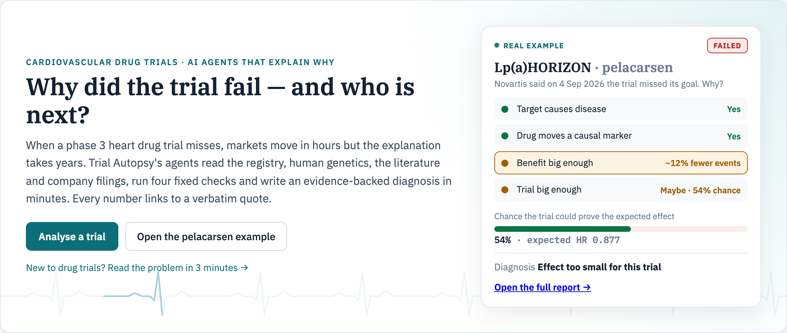

## The problem in one minute

Roughly half of phase 3 cardiovascular outcome trials miss their primary endpoint. When one misses, markets move within hours. On 4 September 2026 Novartis said pelacarsen (Lp(a)HORIZON) had missed. Amgen, which has a drug on the same target, lost about 10% within days. Everyone asked the same question: did the drug fail, did the trial design fail, or is the Lp(a) hypothesis itself wrong?

That explanation usually takes years. After the CETP inhibitors failed in 2012, the genetic explanation was published in 2017.

Trial Autopsy answers in about ten minutes, the way a pathologist works: collect the evidence, run fixed tests, weigh a differential diagnosis, and write a report in which every number links to a verbatim quote from its source.

- **Autopsy** (after the result): why did it fail or succeed?
- **Forecast** (before the result): what is the risk, and where is the weakest link?

---

## What you get

### Four checks, as one causal chain

Each link is a question with a yes, no or number, the quotes behind it and the calculation. The weakest link is marked.

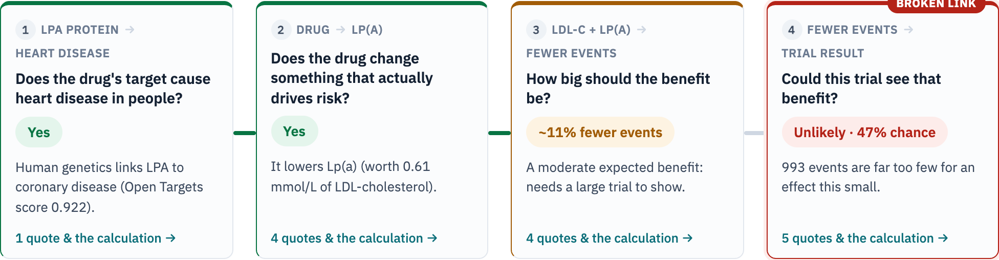

1. **Target:** does human genetics say the drug's target causes heart disease?
2. **Biomarker:** does the drug move a marker that actually drives risk?
3. **Effect size:** how much benefit should that change buy?
4. **Power:** could this trial detect that benefit?

Checks 3 and 4 are computed by code, not by a model: fixed, tested formulas (`app/core/`) whose constants each cite a primary source (`data/reference/coefficients.json`).

### Every number checked against its source in Zetaris

After the calculator runs, the **Verifier** has Nemotron write one Lightning SQL query per number. Zetaris runs it over the trial's registry record and the cited papers, and Nemotron judges what came back: *confirmed*, *not found* or *contradicts*. A contradiction goes to the critic as a serious issue.

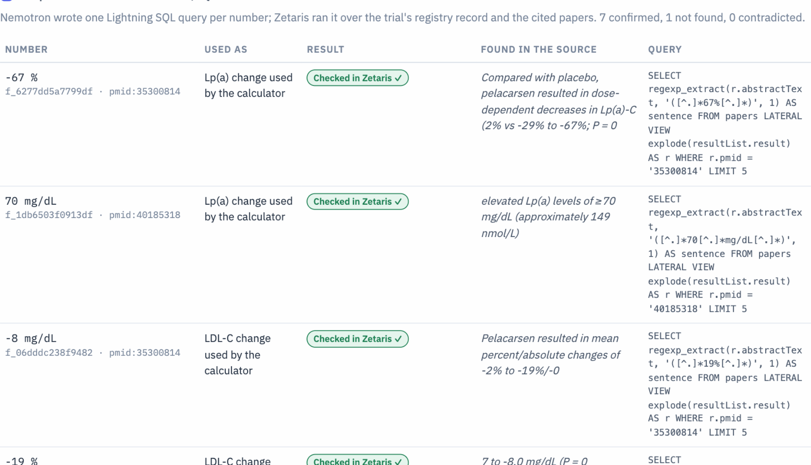

### A critic that can send the work back

The critic reviews the inputs and claims. A serious issue sends the analysis back for a targeted search and a second round, and the report shows what changed. In IMPROVE-IT the Verifier found that the source reported the LDL-C difference differently from the input; the critic sent the work back, and the second round's expected hazard ratio, 0.899, matched the answer key's 0.898.

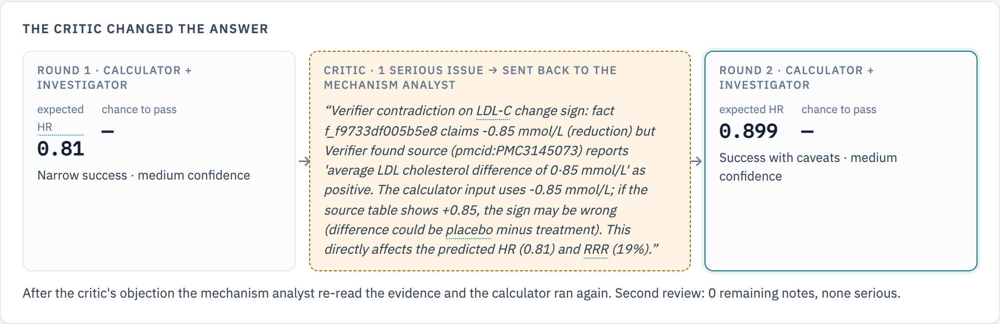

### Evidence you can follow end to end

The evidence map links each source document to its quotes, to what the analyst used, to the calculation and to the verdict.

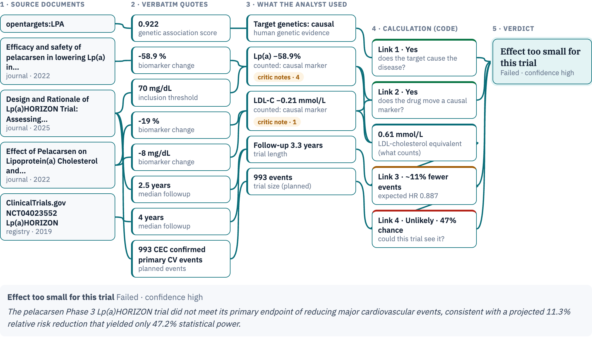

### Who is next, and more

| | |
|---|---|
| 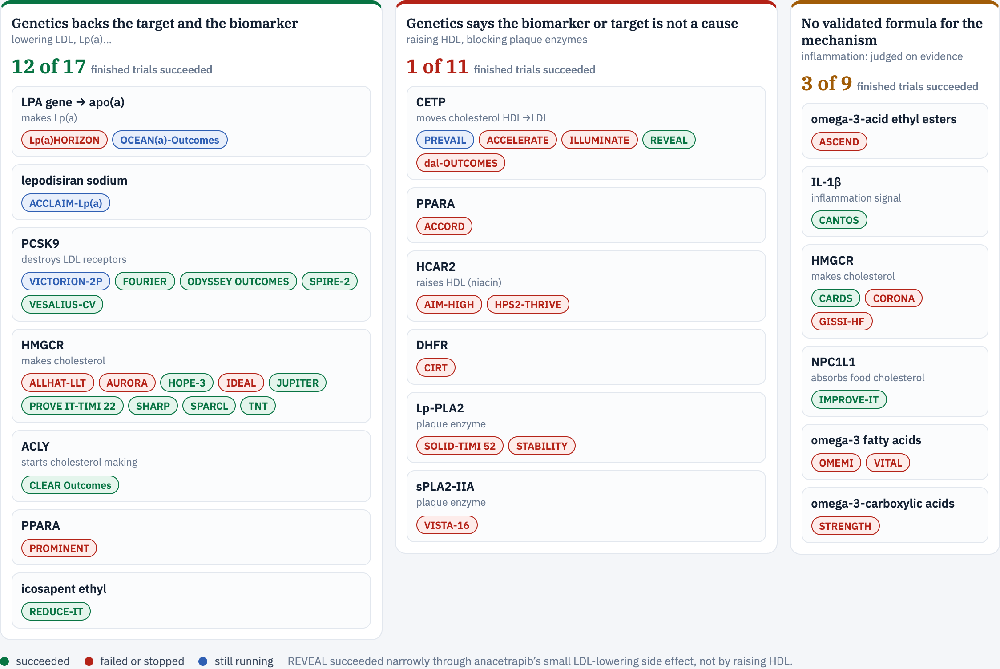 | 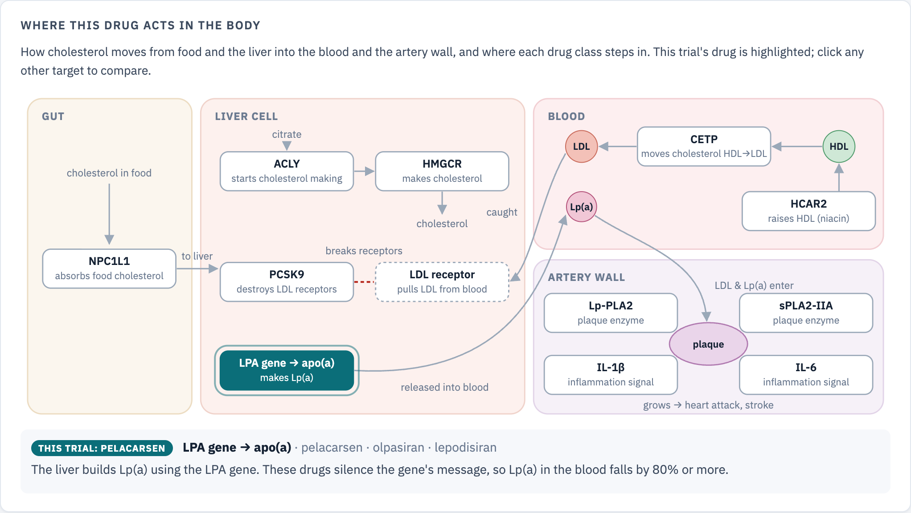 |
| **Target map:** every analysed trial, grouped by what genetics says about its target | **Where the drug acts:** the pathway, with the trial's drug highlighted |
| 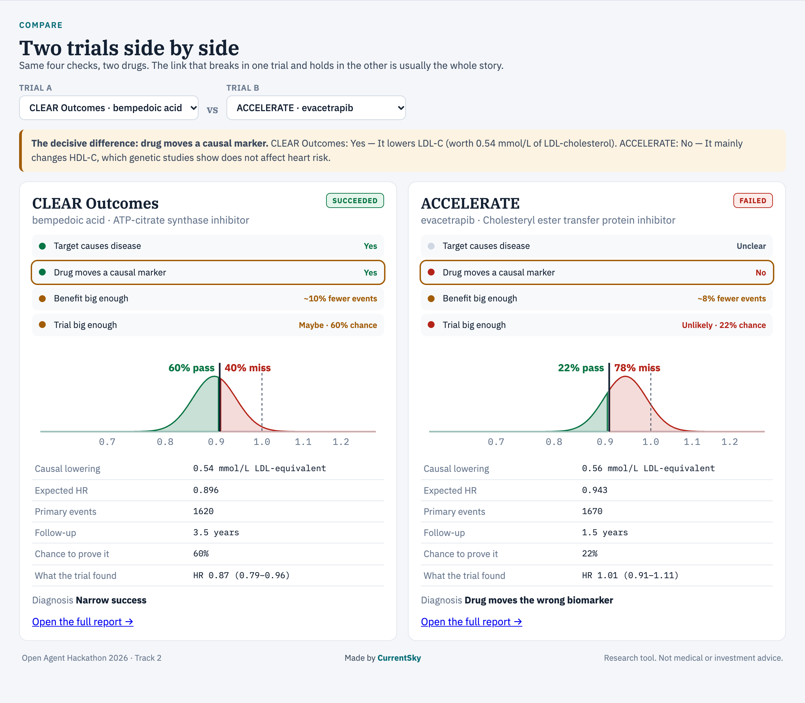 | 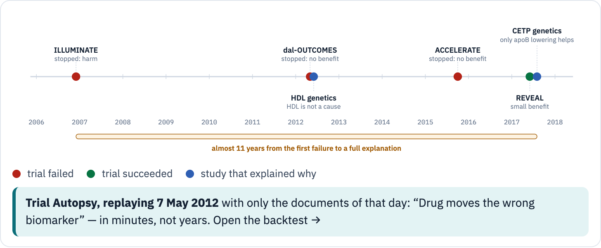 |
| **Compare:** two trials side by side, with the decisive difference | **Time machine:** what the agents could see before the cut-off date |

### Meet the target in 3D

The report shows the drug's target protein in 3D, coloured by its domains or by AlphaFold confidence, and zooms to the place where the drug binds with the surrounding amino acids labelled.

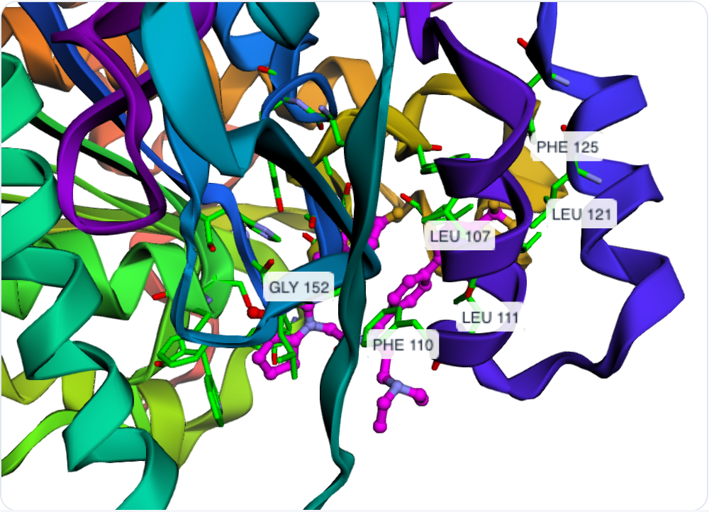

The report also has a replay of every step the agents took and a PDF export.

---

## How it works

<p align="center">
  
</p>

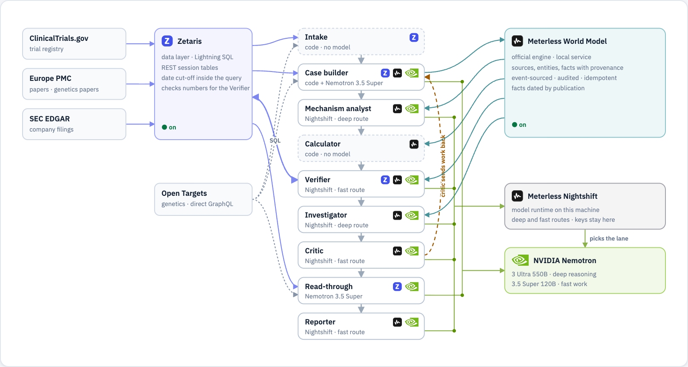

The map above is the top of the app's **Settings** page, live: point at a block to see what it does, what it reads and which model runs it. The same structure as a diagram:

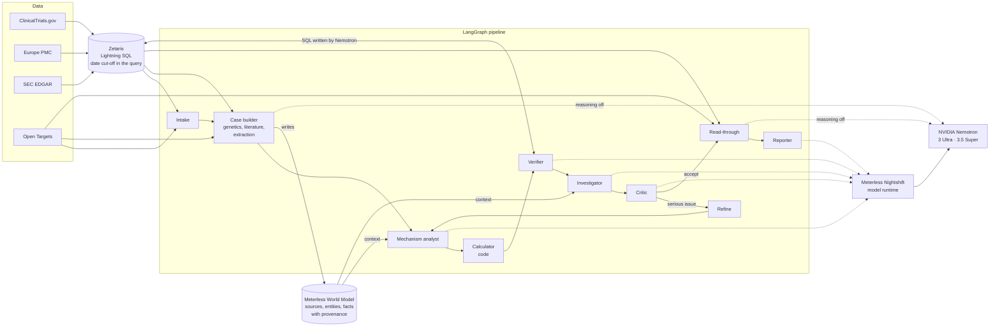

| Step | What it does | Runs on |
|---|---|---|
| Intake | Resolves the trial and the drug, picks autopsy or forecast, checks the scope | code |
| Case builder | Gathers target genetics, the trial's papers and filings, then **extraction** copies out every number with a verbatim quote. Code checks each quote word for word against the document and sets the direction of a change from the source's own words | code + Nemotron 3.5 Super, NVIDIA API, reasoning off |
| Mechanism analyst | Decides the causal pathway and which numbers the calculator gets. Code checks that every number traces to a cited fact | Nemotron through Nightshift |
| Calculator | Four deterministic checks: LDL-equivalent effect, expected hazard ratio, power, verdict | code |
| Verifier | Checks the calculator's numbers against the sources of record with SQL in Zetaris | Nemotron through Nightshift + Zetaris |
| Investigator | Weighs every possible explanation with evidence for and against, including ones no formula covers | Nemotron through Nightshift |
| Critic | Reviews inputs and claims; a serious issue sends the work back (at most two rounds) | Nemotron through Nightshift |
| Read-through | Finds rival drugs on the same target and forecasts them with the calculator | Nemotron 3.5 Super, NVIDIA API, reasoning off |
| Reporter | Writes the report from the verified analysis; it may not add numbers | Nemotron through Nightshift |

**Why it is an agent system, not a chain.** The critic and the Verifier can stop the line and send work back; code checks discard unverified quotes and flag numbers that do not match their facts. All steps share one state: the verified facts in the World Model and the run state in the LangGraph graph (`app/graph.py`).

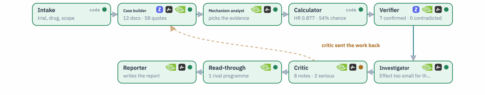

**Time machine.** Every tool takes an `as_of` date. For a blind backtest the agents see only documents published before the trial's result: the registry record in a design-only view, the earlier literature and the topline announcement, frozen once by a fixed rule in `data/archive/` (`scripts/build_archive.py`, nothing added by hand). For live literature reads, Zetaris applies the cut-off inside the SQL query.

---

## Sponsor technology

The full write-up, with code paths and how to check each claim, is [`docs/SPONSOR_TECHNOLOGY.md`](docs/SPONSOR_TECHNOLOGY.md) (also as a PDF).

### Zetaris: the data layer and the fact check

- ClinicalTrials.gov, Europe PMC and SEC EDGAR are read through Zetaris: each request becomes a REST session table read back with Lightning SQL (`app/tools/zetaris.py`).
- The blind-test cut-off runs in that SQL, so a paper from after the cut-off never reaches an agent.
- The Verifier's checks run only in Zetaris: Nemotron writes the SQL, code allows only one read-only `SELECT` over this analysis's tables, Zetaris runs it (`app/agents/verifier.py`). Across the 16 recorded analyses it checked 77 numbers: 45 confirmed, 28 not found in the abstract or registry, 4 contradictions, each of which reached the critic.
- If Zetaris is down, reads fall back to the source directly, the Verifier cannot run, and the report says its numbers were not independently verified.

### Meterless World Model: the evidence store (Build)

- The official Meterless World Model reference engine, unchanged (Apache-2.0), runs as a local service in `services/meterless/`; `run.py` starts it.
- Every source, entity and fact is written to it with provenance: the step that found it, the run, the source URL and the publication date. Across the 16 analyses: 350 entities, 1,250 facts, 418 links, 3,168 audit entries, with each run's audit log in `logs/world-<run_id>.jsonl`.
- The app's own store (`app/engines/world_model.py`) implements the same three services, WorldStore, IngestPipeline and ContextBuilder, and the analyst, calculator, Verifier and investigator build their context from it.
- `npm --prefix services/meterless run conformance` runs the official conformance suite: 8 of 8 checks pass ([evidence](docs/evidence/meterless_world_model_conformance.txt)).

### Meterless Nightshift: the model runtime (Power)

- Nightshift is the primary model provider (`app/llm/meterless_runtime.py`, Meterless Runtime provider contract): the app calls its OpenAI-compatible endpoint with the runtime token, the `meterless-app` and `meterless-scope` headers and a routing mode chosen per step on the Settings page. The NVIDIA key stays in Nightshift.
- In the 16 recorded runs, all 132 reasoning calls went through Nightshift, with no direct fallback, and every answer came from NVIDIA Nemotron ([evidence](docs/evidence/nightshift_runs.md)). Each step's trace records the model that answered.
- Settings has Auto Detect, connect-link paste and a connection test that names the Nemotron lane that answered.

| | |
|---|---|
| 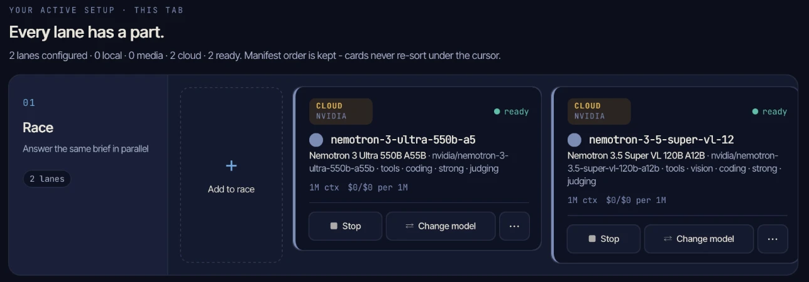 | 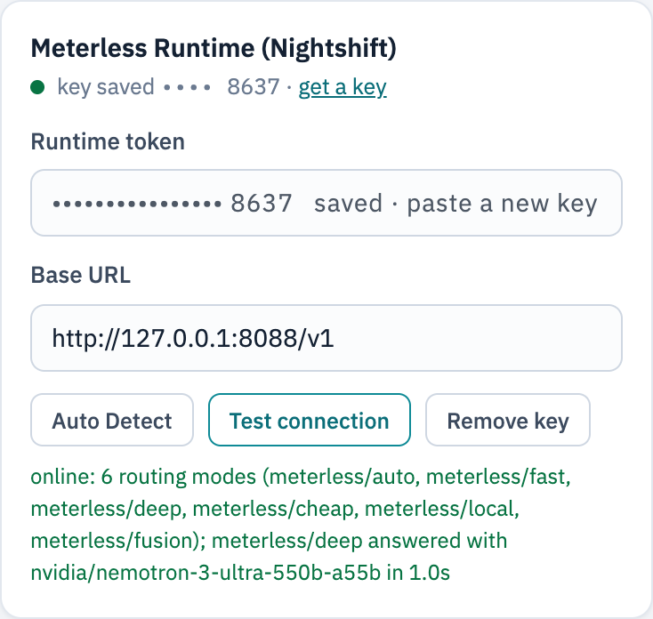 |
| In Nightshift: two NVIDIA Nemotron lanes | In the app: Nightshift online, and the lane that answered |

**What we learned running a full pipeline through Nightshift.** Nightshift is built first for chat, and a pipeline of strict steps needs a few settings. We measured each one and handled it:

| What we found | What it did to the pipeline | How we handle it |
|---|---|---|
| Nightshift hid NVIDIA's models in its lane picker (build 0.92.0) | Nemotron could not be added to a lane | We traced the cause and reported it with the fix ([Meterless/Meterless#4](https://github.com/Meterless/Meterless/issues/4)); Meterless shipped 0.92.1 the same night |
| *Tier-split* (on by default) adds a "planner" step before the request | Strict extraction prompts lost their rules: the same document gave 9 facts directly and 0 through Nightshift | Tier-split off in Nightshift's Preferences |
| The reasoning switch (`chat_template_kwargs`) is not passed to the model | Copying numbers exactly works far better with reasoning off | Extraction and read-through call NVIDIA's API directly with reasoning off; every reasoning step goes through Nightshift |
| For an identified app, the mode bound in Nightshift's Apps panel decides the routing | One routing mode for the whole app | The app is bound to `fast`; Nightshift picks the Nemotron lane |
| A cloud request with no first token after 45 s is cut | Long reasoning prompts on a busy Nemotron 3 Ultra were cut | Streaming, retries, and a direct NVIDIA call after two cuts, recorded in the trace (needed 0 times in the final runs) |
| An answer cache keyed on the last 4,000 characters of the prompt | A near-identical prompt got a previous run's answer back, and a repeated connection test was answered from the cache | Every request, and the connection test, carries a unique reference so the cache cannot replay a stale answer |

### NVIDIA Nemotron: the models

- Every AI step runs on NVIDIA Nemotron: Nemotron 3 Ultra (550B) and Nemotron 3.5 Super (120B). In the final runs Nightshift served the reasoning steps mostly from Ultra; extraction ran on 3.5 Super.
- The critic has its own instructions and reviews the analyst's work, so the steps check each other; malformed JSON is repaired by the same model; calls are paced under the API's rate limit.
- Open models matter here: a drug company cannot send unpublished trial data to a closed cloud model. The same agents can run on the company's own hardware, for example an NVIDIA DGX Spark, which Nightshift supports. (We ran on NVIDIA's API and on Nightshift on a Mac, not on a DGX Spark.)

---

## Results

<p align="center">
  
</p>

The honest test is the **blind backtest**: 14 finished trials replayed with only the documents published before each readout, scored against the explanations experts published later (`data/golden_set/`, never shown to the agents). Results: [`eval/results/backtest_2026-10-23.md`](eval/results/backtest_2026-10-23.md).

| What is scored | NVIDIA Nemotron through Meterless Nightshift |
|---|---|
| Success or failure called right, where the trial could be sized | **9 / 9** |
| Experts' cause named as the main cause | **10 / 14** |
| Experts' cause among the causes named | **11 / 14** |
| Expected hazard ratio within 0.03 of the answer key | **10 / 13** |
| Every number used carries a verbatim quote that passed the code check | 100% |

What the misses teach:
- **Formulas cannot see harm.** In ILLUMINATE, torcetrapib raised blood pressure; no cholesterol formula sees that. The agents named a non-causal biomarker instead of off-target harm.
- **Some trials cannot be sized blind.** In five of the 14 (CANTOS, HPS2-THRIVE, ILLUMINATE, IMPROVE-IT, ODYSSEY OUTCOMES) a number the calculator needs, such as the event count, was not public before the readout, so it says *not computable* instead of guessing. The agents still weigh the evidence: in CANTOS and HPS2-THRIVE they named the experts' main cause without a number to size it.
- **Success has shades.** ODYSSEY OUTCOMES and IMPROVE-IT were called narrow successes or successes with caveats where the experts' labels differ by one step.
- **One bug found by the backtests.** In the first pass, a quote that began mid-sentence ("and by 63% ... vs placebo") carried no direction word, so FOURIER's LDL-C reduction became +63% and the calculator expected harm. Code now reads the start of the sentence in that case (with tests), and FOURIER was rerun: expected HR 0.751 against 0.789 in the answer key.

**A prediction you can check.** Lp(a)HORIZON missed its primary endpoint, but its full results are only due at the AHA Scientific Sessions on 7 November 2026. Before that, we committed the prediction that follows from the diagnosis "effect too small": the overall hazard ratio should land between 0.89 and 1.02, most likely 0.90 to 0.95; a point estimate above 1.02 would prove the diagnosis wrong ([`eval/predictions/2026-10-23_preregistered.md`](eval/predictions/2026-10-23_preregistered.md)). The pelacarsen report shows it with its commit.

Other checks:
- **Calculator on the answer key** (development set): `python -m eval.run_calculator`.
- **Counterfactual tests** (`tests/test_calculator.py`): change the biomarker effect and the verdict must flip, so conclusions follow the data, not the drug's name.
- **Reproducible offline:** `python scripts/check_replay.py` replays all 16 recorded analyses offline; each gives the same outcome, expected HR, power and fact count as its live run.

---

## Quick start

### Docker

```bash
cp .env.example .env
docker build -t trial-autopsy .
docker run --rm -p 8000:8000 --env-file .env trial-autopsy
```

Open http://localhost:8000. With no keys at all, set `SAMPLE_MODE=true` and the recorded analyses replay offline.

### Without Docker

```bash
python -m venv .venv && .venv/bin/pip install -r requirements.txt
npm --prefix services/meterless install      # the Meterless World Model service (Node.js 20+)
.venv/bin/python run.py                      # web app and API on :8000; starts the Meterless service
.venv/bin/python scripts/smoke_test.py       # one PASS line per layer: Zetaris, the engine, Nemotron via Nightshift, Nemotron via NVIDIA
```

### Connect the sponsor services

All of this is on the **Settings** page, which saves to the local `.env` (never committed).

1. **Zetaris** (local Docker install): API URL `http://localhost:8888/api/v1.0`, organisation ID, and an API key from *Management → API Tokens*. Then *Test connection*.
2. **Meterless Nightshift:**
   - in Nightshift: add the NVIDIA key under *Setup → Providers* and two lanes, Nemotron 3 Ultra and Nemotron 3.5 Super, under *Night → Lanes*;
   - in *Setup → Preferences*, set *Tier-split enabled* to **off**;
   - in the app: Meterless card → *Auto Detect* (or paste the URL and runtime token from Nightshift's Console) → *Test connection*;
   - after the first request, bind the app to **fast** in Nightshift's Console (connected apps).
3. **NVIDIA API key** (`NVIDIA_API_KEY`), used by extraction and read-through, which run with reasoning off, and as the fallback when Nightshift cuts a request.

### Offline mode

`SAMPLE_MODE=true` replays recorded runs: source responses from `data/sample_cache/`, model answers from `data/llm_cache/`. The whole pipeline still executes: quotes are checked against the documents, the calculator recomputes every number, the critic decides again. No final answer is stored; a call with no recording returns a structured `ModelOutputNotRecorded` error. The web app works with no network at all (3Dmol.js, mermaid and the fonts are vendored):

```bash
docker run --rm --network none -e SAMPLE_MODE=true trial-autopsy python scripts/check_offline.py
```

### Tests

```bash
.venv/bin/python -m unittest discover tests      # 58 unit and offline end-to-end tests
npm --prefix services/meterless run conformance  # the official Meterless World Model suite, 8 of 8
```

---

## API and logs

`POST /run` runs one analysis and returns JSON:

```bash
curl -X POST http://localhost:8000/run -H "Content-Type: application/json" \
     -d @input_examples/example_1_pelacarsen_autopsy.json
```

```json
{"run_id": "demo-001",
 "input": {"trial": "NCT04023552", "mode": "auto", "readout_text": "...", "as_of": null},
 "options": {"sample_mode": false}}
```

The response holds the verdict, the report, the four checks, the calculator inputs, the hypotheses, the critic's reviews, the Verifier's results, the read-through, every fact and source, the model each step used, and the log file. Errors come back as a structured `error` (`OutOfScope`, `UpstreamSourceError`, `OfflineCacheMiss`, `ModelOutputNotRecorded`).

Every step, handoff, query and send-back is a line in `logs/trace-<run_id>.jsonl`, in the hackathon's log format (timestamp, run_id, agent_name, action, input_summary, output_summary, target_agent, confidence, retry_count, status), mirrored to stdout as `[INFO] run_id=…`. The library keeps each recorded run's trace in `data/library/traces/`.

The logs of the 16 recorded runs are committed in `logs/` (`trace-<run_id>.jsonl` for the steps, `world-<run_id>.jsonl` for the World Model audit). An offline replay writes its result and logs to `data/runs/replay/` and `logs/replay/`, so it never overwrites a live run.

Examples: `input_examples/` (three requests) and `output_examples/` (their responses, each with its `log_file`). Example 3 is the ACCELERATE blind backtest itself, the same run as `bt-accelerate`.

---

## Scope and limitations

- **Phase 3 cardiovascular outcome trials.** Full quantitative analysis for cholesterol, Lp(a) and blood-pressure drugs. For GLP-1, SGLT2 and anti-inflammatory drugs the calculator returns *not computable* rather than a false failure, and the agents judge the evidence qualitatively. Other areas get an honest *out of scope*.
- **Paywalls.** Some key numbers sit behind journal paywalls; the agents use open texts and abstracts and say when a number is missing.
- **Two unverified conversions**, flagged in `app/core/rules.py`: apoB to LDL equivalence and the Lp(a) unit conversion.
- **Genetics is today's data.** In backtests the agents see publication dates and flag evidence published after the cut-off.
- **Model variability.** Two live runs of the same case can pick different numbers; the critic and the Verifier narrow this, the recordings make every run reproducible.

---

## Repository

```
app/                 pipeline (agents, graph), calculator, data tools, World Model, model layer, API, web app
services/meterless/  the official Meterless World Model engine, run as a local service
data/                answer key, reference coefficients, frozen archives, recordings, analysis library, offline cache
eval/                calculator and backtest evaluation, scores
scripts/             archive and library builders, offline check, replay check, smoke test
tests/               unit and offline end-to-end tests
docs/                sponsor technology write-up, evidence, images
input_examples/  output_examples/
logs/                the step logs and World Model audit logs of the recorded runs
```

## Data sources and licences

| Source | Used for | Licence / terms |
|---|---|---|
| ClinicalTrials.gov API v2 | Trial design, status, posted results | public domain (U.S. NLM) |
| Open Targets Platform | Target genetics, drug mechanism, rival programmes | platform terms; ChEMBL data CC BY-SA 3.0 |
| Europe PMC | Abstracts and open full texts | per-article licence; only short quotes are stored |
| SEC EDGAR | The sponsor's result announcement (8-K / 6-K) | public; contact e-mail in the User-Agent |
| `data/reference/coefficients.json` | 21 effect coefficients from primary sources | citations inside |
| `data/golden_set/` | 18 hand-verified trial files, the answer key | citations inside |

The Meterless World Model engine in `services/meterless/engine/` is Apache-2.0 (see its `LICENSE` and `services/meterless/NOTICE`).
