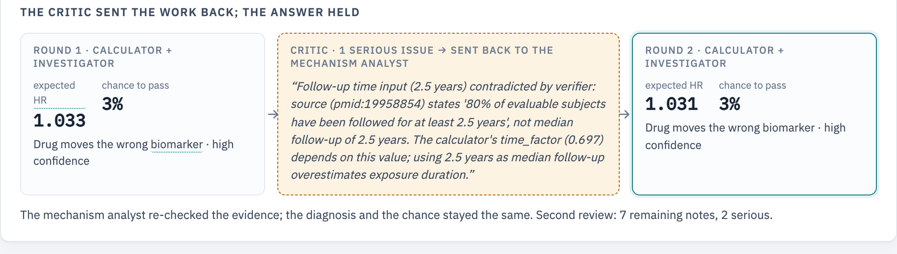
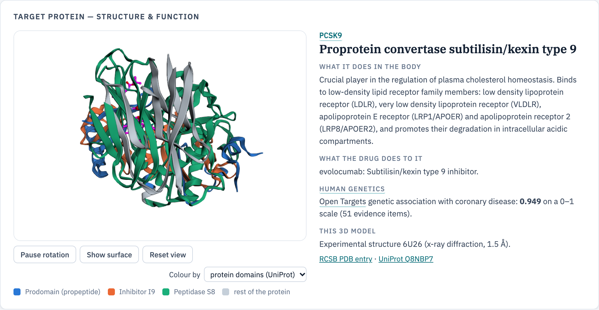
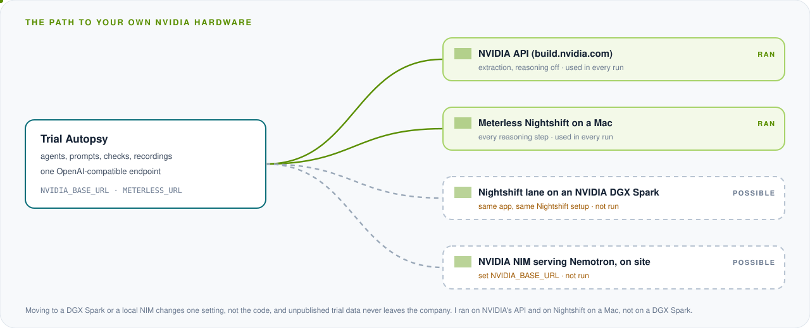

<p align="center">
  
</p>

# Trial Autopsy

**AI agents that explain why a cardiovascular drug trial failed, or is likely to fail, and what that means for every other drug on the same target.**

Open Agent Hackathon 2026 · Track: *The Agent That Can Explain Why* · Team CurrentSky (Stanislav Gatin, solo)

[](https://github.com/stas-gatin/trial-autopsy/actions/workflows/ci.yml)

| | |
|---|---|
| **Input** | A ClinicalTrials.gov ID (and, if you have it, the topline press release) |
| **Output** | A verdict, the main cause, four checks with their numbers, every competing explanation with evidence for and against, forecasts for rival drugs, and every fact with its verbatim quote |
| **Runs on** | NVIDIA Nemotron through **Meterless Nightshift**, data read through **Zetaris**, facts stored in the **Meterless World Model** engine |
| **Start** | `docker compose up --build`, then open http://localhost:8000: offline, no keys needed ([Quick start](#quick-start)) |

> Research tool. Not medical or investment advice.

<p align="center">
  <a href="#quick-start"><b>Quick start</b></a> ·
  <a href="#how-it-works">How it works</a> ·
  <a href="#when-something-goes-wrong">When something goes wrong</a> ·
  <a href="#sponsor-technology">Sponsor technology</a> ·
  <a href="#results">Results</a> ·
  <a href="#api-and-logs">API and logs</a> ·
  <a href="#scope-and-limitations">Limitations</a>
</p>

### Where to find what

| You want | Go to |
|---|---|
| Install and run: one command, `docker compose up --build`, offline with no keys | [Quick start](#quick-start) · [Offline mode](#offline-mode) |
| NVIDIA Nemotron and Meterless Nightshift | [Nemotron](#nvidia-nemotron-the-models-behind-every-ai-step) · [Nightshift](#meterless-nightshift-the-model-runtime-power) · per-run evidence: [`docs/evidence/nightshift_runs.md`](docs/evidence/nightshift_runs.md) |
| How each sponsor technology is used | [Sponsor technology](#sponsor-technology) · full write-up: [`docs/SPONSOR_TECHNOLOGY.md`](docs/SPONSOR_TECHNOLOGY.md) ([PDF](docs/SPONSOR_TECHNOLOGY.pdf)) |
| Zetaris and the Meterless World Model | [Zetaris](#zetaris-the-data-layer-and-the-fact-check) · [World Model](#meterless-world-model-the-evidence-store-build) · [conformance 8/8](docs/evidence/meterless_world_model_conformance.txt) |
| Whether it works | [Results](#results): blind backtest on 36 trials · [`eval/results/`](eval/results/) · [pre-registered forecasts](eval/predictions/) |
| What the agents did, step by step | [`logs/`](logs/) (a trace and a World Model audit per run) · [API and logs](#api-and-logs) |
| Sample inputs and outputs | [`input_examples/`](input_examples/) · [`output_examples/`](output_examples/) |
| Submission metadata | [`metadata.json`](metadata.json) |

---


## The problem in one minute

Roughly half of phase 3 cardiovascular outcome trials miss their primary endpoint. When one misses, markets move within hours. On 4 September 2026 Novartis said pelacarsen (Lp(a)HORIZON) had missed. Amgen, which has a drug on the same target, lost about 10% within days. Everyone asked the same question: did the drug fail, did the trial design fail, or is the Lp(a) hypothesis itself wrong?

That explanation usually takes years. After the CETP inhibitors failed in 2012, the genetic explanation was published in 2017.

Trial Autopsy answers in about a quarter of an hour (median 13 minutes in the live runs), the way a pathologist works: collect the evidence, run fixed tests, weigh a differential diagnosis, and write a report in which every number links to a verbatim quote from its source.

- **Autopsy** (after the result): why did it fail or succeed?
- **Forecast** (before the result): what is the risk, and where is the weakest link?

---

## When something goes wrong

What the agents do when a step fails, what they do without being asked, and how a person can tell afterwards what happened.

**A failed step says so; it does not guess.**
- **No number, no forecast.** If a number the calculator needs (an event count, the between-arm LDL-C difference) is not in the documents published before the cut-off, the result is *not computable*. A missing value is never read as zero, and an Lp(a) or triglyceride drug is never sized by some other small change.
- **Cut model calls are retried and logged.** Nightshift cuts a request whose first token is slow; the app retries, and after two cuts calls NVIDIA directly, and the step log names the provider that answered. A reply cut off mid-thought, with no JSON in it, is repaired by the same model or asked once more.
- **A source that goes down is replaced.** On 24 October 2026 Europe PMC answered every request with HTTP 503 for most of the day; the literature search switched to PubMed (NCBI E-utilities) by itself, with the same date cut-off, and the runs went on. A plain "not found" does not switch sources; an outage does.
- **Failed sources are reported.** If Zetaris is down, the Verifier is marked unavailable and the report lowers its confidence.
- **Out of scope is refused, with the reason.** A blood-pressure strategy with no molecule, or a trial outside cardiometabolic disease, gets a clear refusal instead of a forced answer.

**Checks nobody asked for.**
- The **Verifier** re-checks every number the calculator used against the registry and the cited papers with SQL in Zetaris; a contradiction goes to the critic.
- The **critic** can send the work back. Code then keeps every verified number the critic did not question, so a revision cannot quietly lose evidence.
- **Code** checks every quote word for word against its document (a fact whose quote is not there is kept as unverified and never reaches the calculator or the report), converts units, and reads the direction of a change from the source's own clause.
- The **archive builder** leaves out a paper dated only to the readout month, since it may have been printed after the readout.

**Afterwards, everything can be traced.**
- Every step is in the run's log (`logs/trace-<run>.jsonl`): the agent, the action, a summary of input and output, the model and provider that answered, and whether code or a model did it.
- Every number links to its verbatim quote and source, and every World Model write is in an audit log (`logs/world-<run>.jsonl`).
- Every recorded analysis replays offline to the same result (`scripts/check_replay.py`), and CI checks this on every push, so anyone can rerun the whole backtest without keys.

---

## What you get

### Four checks, as one causal chain

Each link is a question with a yes, no or number, the quotes behind it and the calculation. The weakest link is marked.


1. **Target:** does human genetics say the drug's target causes heart disease?
2. **Biomarker:** does the drug move a marker that actually drives risk?
3. **Effect size:** how much benefit should that change buy?
4. **Power:** could this trial detect that benefit?

Checks 3 and 4 are computed by code, not by a model: fixed, tested formulas (`app/core/`) whose constants each cite a primary source (`data/reference/coefficients.json`).

### Every number checked against its source in Zetaris

After the calculator runs, the **Verifier** has Nemotron write one Lightning SQL query per number. Zetaris runs it over the trial's registry record and the cited papers, and Nemotron judges what came back: *confirmed*, *not found* or *contradicts*. A contradiction goes to the critic as a serious issue.


### A critic that can send the work back

The critic reviews the inputs and claims. A serious issue sends the analysis back for a targeted search and a second round, and the report shows what changed. In dal-OUTCOMES the analyst took "2.5 years" as the median follow-up. The Verifier's SQL in Zetaris brought back the source sentence: 80% of patients had been followed for *at least* 2.5 years, a minimum rather than the median. The critic raised it as a serious issue and sent the work back; the second round kept the diagnosis the experts gave: dalcetrapib raised HDL-C, which does not drive heart risk.



### Evidence you can follow end to end

The evidence map links each source document to its quotes, to what the analyst used, to the calculation and to the verdict.


### Who is next, and more

| | |
|---|---|
|  |  |
| **Target map:** every analysed trial, grouped by what genetics says about its target | **Where the drug acts:** the pathway, with the trial's drug highlighted |
|  |  |
| **Compare:** two trials side by side, with the decisive difference | **Time machine:** what the agents could see before the cut-off date |

### Meet the target in 3D

The report shows the drug's target protein in 3D, next to what it does in the body, what the drug does to it and what human genetics says. It can be coloured by its domains or by AlphaFold confidence, and it zooms to the place where the drug binds with the surrounding amino acids labelled.



The report also has a replay of every step the agents took and a PDF export.

---

## How it works

You give it a trial ID. Nine steps later you get a verdict in which every number links to the sentence it came from. Two kinds of step alternate: **AI steps** read and reason (NVIDIA Nemotron), and **code steps** do everything that must be exact: the arithmetic, the quote checks, the date cut-off.

<p align="center">
  
</p>

**How to read the picture.** The nine boxes are the steps, in order from left to right. A solid box is an AI step, a dashed box is plain code. Top left, **Zetaris** feeds the trial registry, the papers and the company filings into the case builder, and the Verifier later checks every number there with SQL (the dashed blue line). Top right, the **Meterless World Model** stores every verified fact; the analyst and the investigator build their context from it. The orange loop is the **critic** sending the work back to the mechanism analyst when it finds a serious problem. The bar at the bottom: every reasoning step runs on **NVIDIA Nemotron**, served through **Meterless Nightshift**.

### Step by step

| Step | What it does | Runs on |
|---|---|---|
| Intake | Resolves the trial and the drug, picks autopsy or forecast, checks the scope | code |
| Case builder | Gathers target genetics, the trial's papers and filings, then **extraction** copies out every number with a verbatim quote. Code checks each quote word for word against the document and sets the direction of a change from the source's own words | code + Nemotron 3.5 Super, NVIDIA API, reasoning off |
| Mechanism analyst | Decides the causal pathway and which numbers the calculator gets. Code checks that every number traces to a cited fact | Nemotron through Nightshift |
| Calculator | Four deterministic checks: LDL-equivalent effect, expected hazard ratio, power, verdict | code |
| Verifier | Checks the calculator's numbers against the sources of record with SQL in Zetaris | Nemotron through Nightshift + Zetaris |
| Investigator | Weighs every possible explanation with evidence for and against, including ones no formula covers | Nemotron through Nightshift |
| Critic | Reviews inputs and claims; a serious issue sends the work back (at most two rounds) | Nemotron through Nightshift |
| Read-through | Finds rival drugs on the same target and forecasts them with the calculator | Nemotron 3.5 Super, NVIDIA API, reasoning off |
| Reporter | Writes the report from the verified analysis; it may not add numbers | Nemotron through Nightshift |

### What you see in the app


**The system map** at the top of the app's Settings page is the same pipeline as the picture above, drawn with every connection. Left: the data sources and Zetaris, where the registry, papers and filings are read with SQL. Middle: the nine steps; each one shows the logos of what it uses and, for AI steps, the Nightshift route it asks for (deep or fast; Nightshift then picks the Nemotron lane). Right: every fact going into the Meterless World Model, and every reasoning step going through Meterless Nightshift to NVIDIA Nemotron. The dashed orange line is the critic sending the work back. In the app, pointing at any block shows what it does, what it reads and which model runs it.


Every report draws the same nine steps for its own run, with what each step produced. This is pelacarsen: the case builder read 12 documents and kept 58 verbatim quotes; the calculator expected a hazard ratio of 0.877 and a 54% chance that the trial could show the benefit; the Verifier confirmed 7 numbers in Zetaris; the critic sent the work back once (the dashed arrow), and its last review still lists 8 notes, 2 of them serious. The logos on each step show the technology it ran on. The report's replay plays the steps back one by one.

**Why it is an agent system, not a chain.** The critic and the Verifier can stop the line and send work back; code checks discard unverified quotes and flag numbers that do not match their facts. All steps share one state: the verified facts in the World Model and the run state in the LangGraph graph (`app/graph.py`).


**Time machine.** Every tool takes an `as_of` date. For a blind backtest the agents see only documents published before the trial's result: the registry record in a design-only view, the earlier literature and the topline announcement, frozen once by a fixed rule in `data/archive/` (`scripts/build_archive.py`, nothing added by hand). For live literature reads, Zetaris applies the cut-off inside the SQL query.

---

## Sponsor technology

The full write-up, with code paths and how to check each claim, is [`docs/SPONSOR_TECHNOLOGY.md`](docs/SPONSOR_TECHNOLOGY.md) (also as a PDF).

### NVIDIA Nemotron: the models behind every AI step

Every step that reads or reasons runs on NVIDIA Nemotron, and the whole blind backtest below was produced on it: 41 recorded analyses, 945 model calls, 3.6 million tokens.

<p align="center">
  
</p>

**Why Nemotron.** A drug company cannot send unpublished trial data to a closed cloud model. Nemotron is open, so the same agents can run on the company's own NVIDIA hardware (below), and the backtest shows how well they do before anyone trusts them with real data.

**Which model does what, and why.**

| Model | Steps | Why this model |
|---|---|---|
| **Nemotron 3 Ultra** (550B), reasoning on, through Meterless Nightshift | mechanism analyst, Verifier, investigator, critic, reporter: 361 of 377 reasoning calls | The decisions: which numbers describe this trial, the SQL that checks them, eleven competing explanations weighed against the evidence, the critic's review |
| **Nemotron 3.5 Super** (120B), reasoning off, NVIDIA API | extraction and read-through: 568 calls | Copying every number with its exact sentence from each document. Measured on the same document: reasoning off found 9 facts in seconds, reasoning on 0 to 3 in minutes |

**Engineering for Nemotron in a strict pipeline** (`app/llm/generator.py`):
- **The reasoning switch per role.** `chat_template_kwargs.enable_thinking` is set for each step: on where the model must think, off where it must copy exactly.
- **Reasoning kept out of the answer.** Nemotron's reasoning arrives as `<think>…</think>`; code keeps only the answer, even when a proxy drops the opening tag.
- **Broken JSON repaired by the same model.** A reply cut off mid-thought gets one repair pass by the same model, so the content stays the model's own, or is asked once more.
- **Long calls that cannot hang.** Reasoning calls stream; a watchdog closes a stream that goes silent, and after two cut-offs the call goes to NVIDIA directly (4 of 377 reasoning calls), named in the step log.
- **One rate limit shared.** Nightshift calls NVIDIA with the same key, so the app paces every call, through either route, under one limit.
- **The model never does arithmetic.** It finds and quotes numbers; code checks each quote word for word and computes every result.

**Measured on Nemotron.** On 36 finished trials replayed blind, the experts' cause was among the causes the agents named in 35, and their main cause in 26. Success or failure was forecast right in 16 of the 22 trials that could be sized, and all 9 confident forecasts held ([Results](#results)). Every one of the 41 recorded analyses replays offline to the same result.

**On your own NVIDIA hardware.** Every model call goes to an OpenAI-compatible endpoint. Pointing `NVIDIA_BASE_URL` at a local NVIDIA NIM that serves Nemotron, or giving Nightshift a lane on an NVIDIA DGX Spark, moves the whole analysis onto the company's own machine with no code change, and the unpublished data never leaves it. A single DGX Spark is rated for models up to about 200 billion parameters, enough for Nemotron 3.5 Super; Nemotron 3 Ultra needs a larger NVIDIA system. I ran on NVIDIA's API and on Nightshift on a Mac, not on a DGX Spark.

<p align="center">
  
</p>

### Meterless Nightshift: the model runtime (Power)

- Nightshift is the primary model provider (`app/llm/meterless_runtime.py`, Meterless Runtime provider contract): the app calls its OpenAI-compatible endpoint with the runtime token, the `meterless-app` and `meterless-scope` headers and a routing mode chosen per step on the Settings page. The NVIDIA key stays in Nightshift.
- In the 41 recorded runs, 373 of 377 reasoning calls went through Nightshift; the other 4 went to NVIDIA directly after Nightshift cut them twice. Every answer came from NVIDIA Nemotron (361 from Nemotron 3 Ultra, 16 from Nemotron 3.5 Super) ([evidence](docs/evidence/nightshift_runs.md)). Each step's trace records the model that answered.
- By the amount of model work, Nightshift is the main route: 2.54 million of the 3.6 million tokens (71%) and 76% of the generated tokens. By count, more calls go straight to NVIDIA (572 of 945): extraction reads each document in many short calls with reasoning off, which Nightshift cannot pass on yet (see the table below). When it can, extraction moves to Nightshift with one setting.
- Settings has Auto Detect, connect-link paste and a connection test that names the Nemotron lane that answered.

| | |
|---|---|
|  |  |
| In Nightshift: two NVIDIA Nemotron lanes | In the app: Nightshift online, and the lane that answered |

**What I learned running a full pipeline through Nightshift.** Nightshift is built first for chat, and a pipeline of strict steps needs a few settings. I measured each one and handled it:

| What I found | What it did to the pipeline | How the app handles it |
|---|---|---|
| Nightshift hid NVIDIA's models in its lane picker (build 0.92.0) | Nemotron could not be added to a lane | I traced the cause and reported it with the fix ([Meterless/Meterless#4](https://github.com/Meterless/Meterless/issues/4)); Meterless shipped 0.92.1 the same night |
| *Tier-split* (on by default) adds a "planner" step before the request | Strict extraction prompts lost their rules: the same document gave 9 facts directly and 0 through Nightshift | Tier-split off in Nightshift's Preferences |
| The reasoning switch (`chat_template_kwargs`) is not passed to the model | Copying numbers exactly works far better with reasoning off | Extraction and read-through call NVIDIA's API directly with reasoning off; every reasoning step goes through Nightshift |
| For an identified app, the mode bound in Nightshift's Apps panel decides the routing | One routing mode for the whole app | The app is bound to `fast`; Nightshift picks the Nemotron lane |
| A cloud request with no first token after 45 s is cut | Long reasoning prompts on a busy Nemotron 3 Ultra were cut | Streaming, retries, and a direct NVIDIA call after two cuts, recorded in the trace (needed 4 times in the final runs). I reported it, and Meterless is making the limit configurable |
| An answer cache keyed on the last 4,000 characters of the prompt | A near-identical prompt got a previous run's answer back, and a repeated connection test was answered from the cache | Every request, and the connection test, carries a unique reference so the cache cannot replay a stale answer |

### Meterless World Model: the evidence store (Build)

- The official Meterless World Model reference engine, unchanged (Apache-2.0), runs as a local service in `services/meterless/`; `run.py` starts it.
- Every source, entity and fact is written to it with provenance: the step that found it, the run, the source URL and the publication date. Across the 41 analyses: 869 entities, 2,983 facts, 845 links, 7,440 audit entries, with each run's audit log in `logs/world-<run_id>.jsonl`.
- The app's own store (`app/engines/world_model.py`) implements the same three services, WorldStore, IngestPipeline and ContextBuilder, and the analyst, calculator, Verifier and investigator build their context from it.
- `npm --prefix services/meterless run conformance` runs the official conformance suite: 8 of 8 checks pass ([evidence](docs/evidence/meterless_world_model_conformance.txt)).

### Zetaris: the data layer and the fact check

- ClinicalTrials.gov, Europe PMC and SEC EDGAR are read through Zetaris: each request becomes a REST session table read back with Lightning SQL (`app/tools/zetaris.py`).
- The blind-test cut-off runs in that SQL, so a paper from after the cut-off never reaches an agent.
- The Verifier's checks run only in Zetaris: Nemotron writes the SQL, code allows only one read-only `SELECT` over this analysis's tables, Zetaris runs it (`app/agents/verifier.py`). Across the 41 recorded analyses it checked 146 numbers: 99 confirmed, 46 not found in the abstract or registry, 1 contradiction, which reached the critic.
- If Zetaris is down, reads fall back to the source directly, the Verifier cannot run, and the report says its numbers were not independently verified.

### Cursor: development

Cursor was one of the tools I built the app with. I used it to write and run the unit tests (`tests/`), and its Agent to search the codebase for bugs and gaps, which I then fixed.

---

## Results

<p align="center">
  
</p>

The honest test is the **blind backtest**: 36 finished trials replayed with only the documents published before each readout, scored against the explanations experts published later (`data/golden_set/`, never shown to the agents). Six of them (VESALIUS-CV, VITAL, ASCEND, CARDS, OMEMI and CIRT) were added after the analysis code was frozen, and nothing was changed because of their results, so they show how the system does on trials it has not seen. Results: [`eval/results/backtest_2026-10-25.md`](eval/results/backtest_2026-10-25.md) and, for the six, [`backtest_2026-10-25_frozen6.md`](eval/results/backtest_2026-10-25_frozen6.md).

| What is scored | All 36 trials | 6 added after the code freeze |
|---|---|---|
| Experts' cause named as **the** main cause | **26 / 36** | **4 / 6** |
| Success or failure forecast right, from documents before the readout (where the trial could be sized) | **16 / 22** | **1 / 1** |
| Expected hazard ratio within 0.03 of the answer key | 8 / 25 | 0 / 1 |
| *Softer:* one of the causes named (usually two or three) matches one of the experts' causes | 35 / 36 | 6 / 6 |
| Every number used carries a verbatim quote that passed the code check | 100% | 100% |

The explanation is the main output, so it is scored first. In an autopsy the outcome itself is not forecast: code reads it from the announcement, and read it right in 35 of the 36 trials (all but SPIRE-2, below). The expected hazard ratio is a stricter technical check: the agents often size the effect from a different, defensible number than the answer key (an earlier phase, another time point).

**How far to trust a forecast.** For the 18 trials the calculator could size, its probability of success scores a Brier score of 0.137 (always saying 50% scores 0.250). It is right where it is sure, and says so where it is not:

| Probability of success | Trials | Succeeded |
|---|---|---|
| below 20% | 5 | 0 |
| 20% to 80% | 9 | 5 |
| above 80% | 4 | 4 |

What the misses teach:
- **Six wrong forecasts, each with a reason.**
  - AURORA: rosuvastatin cut LDL-C by 41% in patients on dialysis, so the calculator expected a benefit; the trial failed because these patients' heart deaths are mostly not driven by cholesterol, and the agents named exactly that cause, *population*, as the experts did.
  - PROMINENT: earlier trials showed a modest drop in non-HDL-C; in the outcome trial LDL-C and apoB rose instead, which the documents before the readout could not show.
  - CLEAR Outcomes (37%) and SPIRE-2 (43%) sat in the uncertain middle, where a 50% rule is a coin flip.
  - ACCELERATE: the first round called it right, a failure with a 22% chance. The critic sent the work back over the LDL-C input, and the second round raised the chance to 54% and turned the call into a success. A critic round can make an answer worse, and the report shows both rounds.
  - TNT: the analyst extracted a between-arm LDL-C difference of zero, flagged it as implausible, and passed it on anyway, so the calculator saw no effect.
- **The outcome reader misread one announcement.** SPIRE-2 succeeded, but Pfizer's decision the same day to stop developing bococizumab was read as the trial's failure. The code was frozen by then, so this is reported as a miss rather than tuned away.
- **Some trials cannot be sized blind.** In 14 of the 36 a number the calculator needs, such as the event count or the biomarker change, was not in the documents before the readout, so it says *not computable* instead of guessing. The agents still weigh the evidence: in 9 of those 14 they named the experts' main cause without a number to size it. In five of the six trials added after the freeze the archive held no measured lipid change before the readout (CARDS, three omega-3 trials, and CIRT, whose drug does not lower lipids), and the calculator abstained in every one.
- **Success has shades.** In JUPITER, SHARP and SPARCL the agents and the experts drew the line between a robust, a narrow and a caveated success differently.

**Predictions you can check.** Lp(a)HORIZON missed its primary endpoint, but its full results are only due at the AHA Scientific Sessions on 7 November 2026. Before that, I committed the prediction that follows from the diagnosis "effect too small": the overall hazard ratio should land between 0.89 and 1.02, most likely 0.90 to 0.95; a point estimate above 1.02 would prove the diagnosis wrong ([`eval/predictions/2026-10-23_preregistered.md`](eval/predictions/2026-10-23_preregistered.md)). The pelacarsen report shows it with its commit. The prediction came from the run of 22–23 October (expected HR 0.887, kept in git at that commit); the fresh run of 25 October gives 0.877, inside the same range. Three trials that have not read out are forecast the same way ([`eval/predictions/2026-10-25_preregistered.md`](eval/predictions/2026-10-25_preregistered.md)): PREVAIL (obicetrapib) and VICTORION-2P (inclisiran) should both meet their primary endpoint, with a hazard ratio between 0.71 and 0.94; for ACCLAIM-Lp(a) (lepodisiran) the analysis abstained, because it found no verified Lp(a) change for the phase 3 dose.

Other checks:
- **Calculator on the answer key** (development set): `python -m eval.run_calculator`.
- **Counterfactual tests** (`tests/test_calculator.py`): change the biomarker effect and the verdict must flip, so conclusions follow the data, not the drug's name.
- **Reproducible offline:** `python scripts/check_replay.py` replays all 41 recorded analyses offline; each gives the same outcome, expected HR, power and fact count as its live run.

---

## Quick start

### One command (Docker)

You need [Docker](https://docs.docker.com/get-docker/) (Docker Desktop on macOS and Windows) and Git. Clone the repository and start it:

```bash
git clone https://github.com/stas-gatin/trial-autopsy.git
cd trial-autopsy
docker compose up --build
```

The first build installs every dependency inside the image (Python packages and the Node.js service), so nothing else needs installing on your machine.

Open http://localhost:8000. Nothing else is needed: with no `.env` the app runs **offline** (`SAMPLE_MODE=true`), and all 41 recorded analyses open and replay from the repository, with no keys and no network. Stop it with Ctrl+C.

Check that everything works offline, in a second terminal:

```bash
docker compose exec trial-autopsy python scripts/check_offline.py   # every page and recorded analysis, no network
docker compose exec trial-autopsy python scripts/check_replay.py    # all 41 analyses reproduce their live result
```

**Live runs** (a new trial ID): `cp .env.example .env`, fill in the keys ([Connect the sponsor services](#connect-the-sponsor-services)), set `SAMPLE_MODE=false`, and run `docker compose up --build` again. Inside Docker, services on your own machine are reached as `host.docker.internal`, for example `METERLESS_BASE_URL=http://host.docker.internal:8088/v1` and `ZETARIS_REST_URL=http://host.docker.internal:8888/api/v1.0`.

### Without Docker

You need Python 3.12 and Node.js 20 or newer.

```bash
git clone https://github.com/stas-gatin/trial-autopsy.git && cd trial-autopsy
python -m venv .venv && .venv/bin/pip install -r requirements.txt
npm --prefix services/meterless install      # the Meterless World Model service (Node.js 20+)
SAMPLE_MODE=true .venv/bin/python run.py     # offline, no keys: web app and API on :8000, starts the Meterless service
.venv/bin/python run.py                      # live, with the keys in .env
.venv/bin/python scripts/smoke_test.py       # live setup check, one PASS line per layer: Zetaris, the engine, Nemotron via Nightshift, Nemotron via NVIDIA
```

### Connect the sponsor services

All of this is on the **Settings** page, which saves to the local `.env` (never committed).

1. **Zetaris** (local Docker install): API URL `http://localhost:8888/api/v1.0`, organisation ID, and an API key from *Management → API Tokens*. Then *Test connection*.
2. **Meterless Nightshift:**
   - in Nightshift: add the NVIDIA key under *Setup → Providers* and two lanes, Nemotron 3 Ultra and Nemotron 3.5 Super, under *Night → Lanes*;
   - in *Setup → Preferences*, set *Tier-split enabled* to **off**;
   - in the app: Meterless card → *Auto Detect* (or paste the URL and runtime token from Nightshift's Console) → *Test connection*;
   - after the first request, bind the app to **fast** in Nightshift's Console (connected apps).
3. **NVIDIA API key** (`NVIDIA_API_KEY`), used by extraction and read-through, which run with reasoning off, and as the fallback when Nightshift cuts a request.

### Offline mode

`SAMPLE_MODE=true` replays recorded runs: source responses from `data/sample_cache/`, model answers from `data/llm_cache/`. The whole pipeline still executes: quotes are checked against the documents, the calculator recomputes every number, the critic decides again. No final answer is stored; a call with no recording returns a structured `ModelOutputNotRecorded` error. The web app works with no network at all (3Dmol.js, mermaid and the fonts are vendored):

```bash
docker run --rm --network none -e SAMPLE_MODE=true trial-autopsy python scripts/check_offline.py
```

### Tests

```bash
.venv/bin/python -m unittest discover tests      # 106 unit and offline end-to-end tests
npm --prefix services/meterless run conformance  # the official Meterless World Model suite, 8 of 8
```

GitHub Actions runs all of this on every push and pull request ([`.github/workflows/ci.yml`](.github/workflows/ci.yml)): the tests, the offline check, a replay of every recorded analysis against its live result (`scripts/check_replay.py`), and the Meterless conformance suite.

---

## API and logs

`POST /run` runs one analysis and returns JSON:

```bash
curl -X POST http://localhost:8000/run -H "Content-Type: application/json" \
     -d @input_examples/example_1_pelacarsen_autopsy.json
```

```json
{"run_id": "demo-001",
 "input": {"trial": "NCT04023552", "mode": "auto", "readout_text": "...", "as_of": null},
 "options": {"sample_mode": false}}
```

The response holds the verdict, the report, the four checks, the calculator inputs, the hypotheses, the critic's reviews, the Verifier's results, the read-through, every fact and source, the model each step used, and the log file. Errors come back as a structured `error` (`OutOfScope`, `UpstreamSourceError`, `OfflineCacheMiss`, `ModelOutputNotRecorded`).

Every step, handoff, query and send-back is a line in `logs/trace-<run_id>.jsonl`, in the hackathon's log format (timestamp, run_id, agent_name, action, input_summary, output_summary, target_agent, confidence, retry_count, status), mirrored to stdout as `[INFO] run_id=…`. The library keeps each recorded run's trace in `data/library/traces/`.

The logs of the 41 recorded runs are committed in `logs/` (`trace-<run_id>.jsonl` for the steps, `world-<run_id>.jsonl` for the World Model audit). An offline replay writes its result and logs to `data/runs/replay/` and `logs/replay/`, so it never overwrites a live run.

Examples: `input_examples/` (six requests: one autopsy, one backtest and four forecasts) and `output_examples/` (their responses, each with its `log_file`). Example 3 is the ACCELERATE blind backtest itself, the same run as `bt-accelerate`.

---

## Scope and limitations

- **Phase 3 cardiovascular outcome trials.** Full quantitative analysis for cholesterol, Lp(a) and blood-pressure drugs. For GLP-1, SGLT2 and anti-inflammatory drugs the calculator returns *not computable* rather than a false failure, and the agents judge the evidence qualitatively. Other areas get an honest *out of scope*.
- **Paywalls.** Some key numbers sit behind journal paywalls; the agents use open texts and abstracts and say when a number is missing.
- **Two unverified conversions**, flagged in `app/core/rules.py`: apoB to LDL equivalence and the Lp(a) unit conversion.
- **Genetics is today's data.** In backtests the agents see publication dates and flag evidence published after the cut-off.
- **Model variability.** Two live runs of the same case can pick different numbers; the critic and the Verifier narrow this, the recordings make every run reproducible.

---

## Repository

```
app/                 pipeline (agents, graph), calculator, data tools, World Model, model layer, API, web app
services/meterless/  the official Meterless World Model engine, run as a local service
data/                answer key, reference coefficients, frozen archives, recordings, analysis library, offline cache
eval/                calculator and backtest evaluation, scores
scripts/             archive and library builders, offline check, replay check, smoke test
tests/               unit and offline end-to-end tests
docs/                sponsor technology write-up, evidence, images
input_examples/  output_examples/
logs/                the step logs and World Model audit logs of the recorded runs
```

## Data sources and licences

| Source | Used for | Licence / terms |
|---|---|---|
| ClinicalTrials.gov API v2 | Trial design, status, posted results | public domain (U.S. NLM) |
| Open Targets Platform | Target genetics, drug mechanism, rival programmes | platform terms; ChEMBL data CC BY-SA 3.0 |
| Europe PMC | Abstracts and open full texts | per-article licence; only short quotes are stored |
| PubMed / PubMed Central (NCBI E-utilities) | The same, when Europe PMC is down | NLM terms; per-article licence |
| SEC EDGAR | The sponsor's result announcement (8-K / 6-K) | public; contact e-mail in the User-Agent |
| `data/reference/coefficients.json` | 21 effect coefficients from primary sources | citations inside |
| `data/golden_set/` | 40 hand-verified trial files, the answer key | citations inside |

The Meterless World Model engine in `services/meterless/engine/` is Apache-2.0 (see its `LICENSE` and `services/meterless/NOTICE`).
